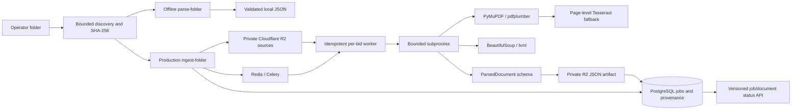
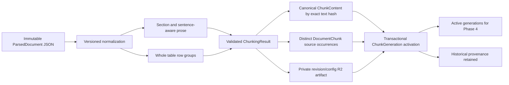

# RFP platform architecture through Phase 3

The API, operator CLI and Celery worker share Settings, the SQLAlchemy model/engine factory,
the existing R2 Storage protocol and application logging conventions.

Only the production path persists R2/PostgreSQL state. Parser modules accept bytes and
non-secret options; offline parsing requires neither live credentials nor infrastructure.
Untrusted source content is data only; no LLM, remote link resolution or executable HTML is used.

Source IDs include bid identity, relative path and original source SHA-256. Jobs include sorted
source identities and parser configuration/version. PostgreSQL advisory locks serialize all
registration/processing for a bid; document commits checkpoint successful work. R2 artifact
keys are stable by source/configuration. Duplicate terminal deliveries have no side effects.
Storage retry policy distinguishes transient provider/network failures from permanent errors.

ProcessingJob keeps its persisted parser configuration; workers never silently parse it with
different current defaults. Documents retain source/parsed keys and statuses, while job membership
is explicit in `job_documents`. Phase 1 rows can have null new provenance columns and remain valid.
The migration is reversible; downgrading maps partial states to failed before restoring the old
status constraint and removes only Phase 2 schema additions.

R2 writes, DB commits and broker publication cannot be atomic. Failed source registration can
leave reusable orphan objects. Queue publication follows DB commit; `dispatch-job` recovers
queued or interrupted jobs after broker/worker outages. Terminal parse failures are preserved.

Provenance includes one-based physical PDF pages and HTML element/heading/ID/table locators.
Native text and tables are both retained. OCR scores are recognition diagnostics. Scanned table
text is retained with a warning and no invented cells. No chunking, indexing, semantic deduplication,
embeddings, retrieval, agents, comparison or frontend is present in Phase 2.

## Phase 3 preparation

`chunk-folder` operates locally without infrastructure or `.env`. `chunk-bid` registers production
jobs against current parsed document revisions and queues `rfp.chunk` on the existing Celery app.
There is no second Settings, storage adapter, DB connection layer or job framework. The existing
job-status API understands both ingestion and chunk jobs; generation inspection has a versioned
endpoint. Preparation is operator-triggered after parsing.

Source SHA-256 detects duplicate files, canonical SHA-256 identifies reusable normalized text,
and every occurrence retains its own document authority and locator. Shared content never means
shared source authority. Section metadata stays occurrence-specific; canonical text is the exact
text whose hash Phase 4 may use for embedding computation reuse. Lists/headings/OCR/table rows
are distinct chunk types. PDF ranges cover all contributing segments; HTML uses null pages.

Prose targets 600/800 estimated tokens with 100 overlap within continuous sections only. The
replaceable default counter uses ceil(UTF-8 bytes / 4), not an embedding-model tokenizer. Whole
table rows retain repeated headers, cell arrays and row/page citations; oversized indivisible
rows are warned rather than sliced. Exact whole-table prose copies are suppressed only when
unambiguous; uncertain duplicates and repeated legal statements remain evidence.

Migration 0003 introduces canonical content, source occurrences, generation/job membership and
parsed-artifact integrity hashes. A generation binds document revision, exact parsed-artifact
SHA-256 and full effective config/version hash. DB constraints enforce content/occurrence/input
uniqueness and one active generation per bid/source path. Prior generations remain historical.

Processing holds the existing per-bid advisory lock. Source input identity is snapshotted during
registration and rechecked against the latest document before execution. R2 reads/writes use
existing bounded retry helpers. Only a successfully stored/validated generation is persisted;
canonical content and occurrences are inserted with atomic activation in one DB transaction.
A failure cannot replace active chunks. Partial results preserve a prior complete generation.
Cross-bid canonical writes are conflict-safe; duplicate task deliveries create no new rows.

Legacy Phase 2 parsed hashes are backfilled once. Adding a new document processes just that new
document, while a source/config change creates an identifiable generation. A broker outage can
leave a queued job; `dispatch-job` recovers it. R2/DB are not a distributed transaction, so failed
DB activation can leave an orphan deterministic artifact but no partial active state.

Before Phase 4, select the embedding model/tokenizer, include model/input transformation in the
embedding-cache identity, and use active occurrences for metadata filters and citations. Do not
collapse addendum/RFP authority or cross-bid access boundaries when reusing canonical content.
No embeddings, Qdrant writes, BM25, retrieval, agents, extraction or reconciliation are implemented.
