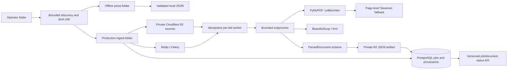

# Phase 2 ingestion architecture

The API, operator CLI and Celery worker share Settings, the SQLAlchemy model/engine factory,
the existing R2 Storage protocol and application logging conventions.

Only the production path persists R2/PostgreSQL state. Parser modules accept bytes and
non-secret options; offline parsing requires neither live credentials nor infrastructure.
Untrusted source content is data only; no LLM, remote link resolution or executable HTML is used.

Source IDs include bid identity, relative path and original source SHA-256. Jobs include sorted
source identities and parser configuration/version. PostgreSQL advisory locks serialize all
registration/processing for a bid; document commits checkpoint successful work. R2 artifact
keys are stable by source/configuration. Duplicate terminal deliveries have no side effects.
Storage retry policy distinguishes transient provider/network failures from permanent errors.

ProcessingJob keeps its persisted parser configuration; workers never silently parse it with
different current defaults. Documents retain source/parsed keys and statuses, while job membership
is explicit in `job_documents`. Phase 1 rows can have null new provenance columns and remain valid.
The migration is reversible; downgrading maps partial states to failed before restoring the old
status constraint and removes only Phase 2 schema additions.

R2 writes, DB commits and broker publication cannot be atomic. Failed source registration can
leave reusable orphan objects. Queue publication follows DB commit; `dispatch-job` recovers
queued or interrupted jobs after broker/worker outages. Terminal parse failures are preserved.

Provenance includes one-based physical PDF pages and HTML element/heading/ID/table locators.
Native text and tables are both retained. OCR scores are recognition diagnostics. Scanned table
text is retained with a warning and no invented cells. No chunking, indexing, semantic deduplication,
embeddings, retrieval, agents, comparison or frontend is present in Phase 2.
