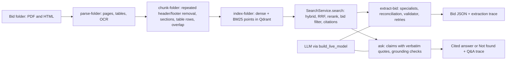
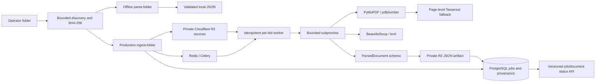
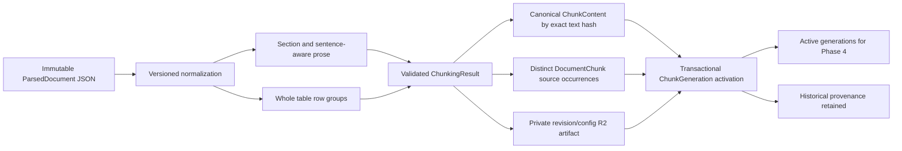
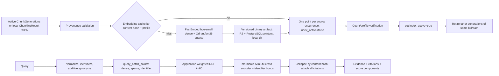
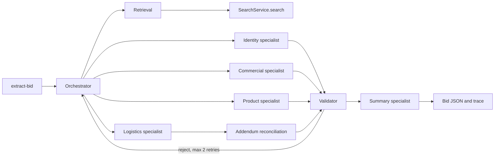
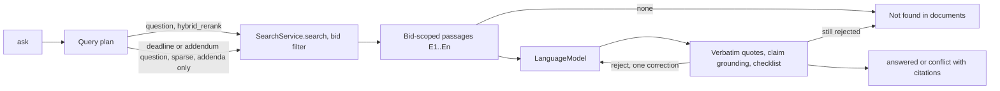
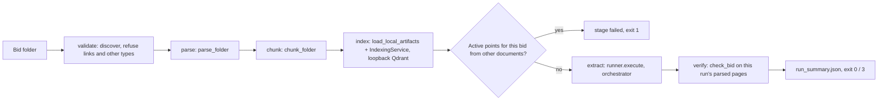

# RFP platform architecture through Phase 10

## End-to-end workflow

`process-bid` (Phase 10, below) runs this whole chain for one local folder. The individual
commands remain available.

Agents communicate through typed Pydantic contracts: `EvidenceHit`, `DraftField`,
`FieldValidation`, `AddendumChange` and `ModelReply`. Shared state lives in `ExtractionState`;
nothing passes as free text. Every search call carries the bid filter, so evidence from another
bid cannot reach a model prompt. Live results for both bids are in `docs/live_validation.md`.

The API, operator CLI and Celery worker share Settings, the SQLAlchemy model/engine factory,
the existing R2 Storage protocol and application logging conventions.

Only the production path persists R2/PostgreSQL state. Parser modules accept bytes and
non-secret options; offline parsing requires neither live credentials nor infrastructure.
Untrusted source content is data only; no LLM, remote link resolution or executable HTML is used.

Source IDs include bid identity, relative path and original source SHA-256. Jobs include sorted
source identities and parser configuration/version. PostgreSQL advisory locks serialize all
registration/processing for a bid; document commits checkpoint successful work. R2 artifact
keys are stable by source/configuration. Duplicate terminal deliveries have no side effects.
Storage retry policy distinguishes transient provider/network failures from permanent errors.

ProcessingJob keeps its persisted parser configuration; workers never silently parse it with
different current defaults. Documents retain source/parsed keys and statuses, while job membership
is explicit in `job_documents`. Phase 1 rows can have null new provenance columns and remain valid.
The migration is reversible; downgrading maps partial states to failed before restoring the old
status constraint and removes only Phase 2 schema additions.

R2 writes, DB commits and broker publication cannot be atomic. Failed source registration can
leave reusable orphan objects. Queue publication follows DB commit; `dispatch-job` recovers
queued or interrupted jobs after broker/worker outages. Terminal parse failures are preserved.

Provenance includes one-based physical PDF pages and HTML element/heading/ID/table locators.
Native text and tables are both retained. OCR scores are recognition diagnostics. Scanned table
text is retained with a warning and no invented cells. No chunking, indexing, semantic deduplication,
embeddings, retrieval, agents, comparison or frontend is present in Phase 2.

## Phase 3 preparation

`chunk-folder` operates locally without infrastructure or `.env`. `chunk-bid` registers production
jobs against current parsed document revisions and queues `rfp.chunk` on the existing Celery app.
There is no second Settings, storage adapter, DB connection layer or job framework. The existing
job-status API understands both ingestion and chunk jobs; generation inspection has a versioned
endpoint. Preparation is operator-triggered after parsing.

Source SHA-256 detects duplicate files, canonical SHA-256 identifies reusable normalized text,
and every occurrence retains its own document authority and locator. Shared content never means
shared source authority. Section metadata stays occurrence-specific; canonical text is the exact
text whose hash Phase 4 may use for embedding computation reuse. Lists/headings/OCR/table rows
are distinct chunk types. PDF ranges cover all contributing segments; HTML uses null pages.

Prose targets 600/800 estimated tokens with 100 overlap within continuous sections only. The
replaceable default counter uses ceil(UTF-8 bytes / 4), not an embedding-model tokenizer. Whole
table rows retain repeated headers, cell arrays and row/page citations; oversized indivisible
rows are warned rather than sliced. Exact whole-table prose copies are suppressed only when
unambiguous; uncertain duplicates and repeated legal statements remain evidence.

**Repeated page furniture (Phase C).** Before pieces are built, `chunking/furniture.py` `detect`
groups native PDF text blocks that lie in the top or bottom 12% of the document's text extent. A
block's group key is its casefolded, punctuation-collapsed text; page counters are digit-masked. A
group is removed only if all of these hold:

- it appears on at least 3 pages, covering at least half of its page span;
- it is at most 160 characters;
- it contains no requirement wording.

The first occurrence in each document is kept, except for bare page counters. `chunk_document`
skips those block ids, so page numbers, locators and offsets do not change, and parsed artifacts
are not modified. The mode is part of `ChunkConfig` (`page_furniture`). Its default in `Settings`
is `repeated_v1`, and the legacy `keep` reproduces the old generation hashes. The mode is part of
the generation fingerprint, so a cleaned run never shares point ids with an old one. HTML, OCR
lines and PDFs under 3 pages are not processed.

Migration 0003 introduces canonical content, source occurrences, generation/job membership and
parsed-artifact integrity hashes. A generation binds document revision, exact parsed-artifact
SHA-256 and full effective config/version hash. DB constraints enforce content/occurrence/input
uniqueness and one active generation per bid/source path. Prior generations remain historical.

Processing holds the existing per-bid advisory lock. Source input identity is snapshotted during
registration and rechecked against the latest document before execution. R2 reads/writes use
existing bounded retry helpers. Only a successfully stored/validated generation is persisted;
canonical content and occurrences are inserted with atomic activation in one DB transaction.
A failure cannot replace active chunks. Partial results preserve a prior complete generation.
Cross-bid canonical writes are conflict-safe; duplicate task deliveries create no new rows.

Legacy Phase 2 parsed hashes are backfilled once. Adding a new document processes just that new
document, while a source/config change creates an identifiable generation. A broker outage can
leave a queued job; `dispatch-job` recovers it. R2/DB are not a distributed transaction, so failed
DB activation can leave an orphan deterministic artifact but no partial active state.

Before Phase 4, select the embedding model/tokenizer, include model/input transformation in the
embedding-cache identity, and use active occurrences for metadata filters and citations. Do not
collapse addendum/RFP authority or cross-bid access boundaries when reusing canonical content.
No embeddings, Qdrant writes, BM25, retrieval, agents, extraction or reconciliation are implemented.

## Phase 4 hybrid search

`rfp.search` is a library first: `SearchService.search(SearchRequest) -> SearchResponse` and
`IndexingService.index(generations)` are what the API, CLI, Celery task and future LangGraph tools
call. All inference happens through `ModelRuntime`, a lazy per-process loader guarded by a bounded
semaphore; the API additionally runs searches in a capacity-limited worker thread with a timeout.
Model downloads happen only via `init-models` unless `SEARCH__ALLOW_MODEL_DOWNLOAD=true`.

**Embedding profile.** A SHA-256 over dense identity (model, source, ONNX file SHA-256, dim,
max tokens, normalization, FastEmbed version), sparse identity (model, stopwords hash, BM25
k/b/avg_len/language, IDF modifier) and the input representation `canonical_text_v1`. The
collection is `{QDRANT_COLLECTION}__{profile[:12]}` with named vectors `dense` (cosine, 384) and
`bm25` (sparse, `Modifier.IDF`). A model or parameter change therefore yields a new collection and
a cold cache; models are never mixed in one collection. An existing collection with a different
vector configuration raises `collection_incompatible`; collections are never deleted or recreated.

**Text representation.** Exact canonical chunk text is embedded, so identical text in different
documents shares vectors while each occurrence keeps its own bid/document/addendum/page/locator
payload. The BGE query instruction is applied to dense queries only. Inputs beyond 512 tokens are
truncated by the tokenizer; this is recorded as `embedding_truncated` and a payload warning.

**Indexing.** Each generation is processed independently: unchanged detection (exact active/total
counts for the generation and profile), cache lookup, batched embedding of misses, cache write,
batched upsert with bounded retries, verification, activation and supersession. Any failure
deletes only that generation's inactive staging points, so previously active evidence stays
searchable. A transient Qdrant failure stops the run and leaves the remaining generations pending.
Production jobs reuse `ProcessingJob(kind="indexing")`, the per-bid advisory lock, deterministic
job IDs (bid + configured profile key + generation manifest), `chunk_index_states` per
generation/profile, deadline continuations and Celery retries for transient cache/vector-store
failures. Production embedding artifacts must go to R2; there is no local fallback.

**Retrieval.** Branch queries share one metadata filter that always includes `index_active=true`
and the profile fingerprint, plus optional bid, document, doc type, addendum, chunk type and path
filters. The identifier branch is a dense query restricted to points whose `identifiers` payload
contains a normalized or compact query identifier, because BM25 tokenization splits `PX-420`.
Fusion is weighted RRF over ranks (never raw scores). `hybrid_rerank` reranks the fused top
`rerank_depth` with the cross-encoder; matching identifiers add `identifier_rerank_bonus`. Under
`identifier_policy=require_evidence` a query naming identifiers that no candidate contains returns
no results with `identifier_evidence_not_found` instead of semantically similar but wrong evidence.
Results are collapsed by content hash and every filter-valid occurrence is attached as an
additional citation. Reranker/sparse failures are errors unless `allow_degraded` is enabled, in
which case the response is flagged `degraded` with a warning.

**Vector-store compatibility.** `qdrant-client` 1.19.x is pinned against Qdrant server 1.19.2
(cloud and compose). The client's background compatibility warning is enabled, and
`CollectionManager.check_server` enforces the same rule synchronously (equal major, minor
difference ≤ 1, server ≥ 1.10) before indexing or searching.

Structured logs record timings, candidate counts, score components, profile and a query hash, not
query text, document text, signed URLs or secrets. Phase 4 returns evidence only.

## Phase 5 extraction

`extract-bid` is read-only against loopback Qdrant. Independent field groups call the model
concurrently. Search calls on the shared client are serialized. The validator accepts a value
only when the cited hit belongs to the bid and the value is supported by that hit's text.
Addendum number alone does not override a field. Live model calls use `LLM_PROVIDER`,
`LLM_MODEL` and `LLM_API_KEY`. Missing credentials stop the command.

A field can have several query steps, such as primary, addendum-only, specs-only or label search.
Their hits are merged round-robin by rank, so each step reaches the eight passages the specialist
sees. The prompt names the exact field keys. The reconciler takes the original due date only from
a date that follows a due-date label, never from the first date on a page. Output `confidence`
is a fixed value per validation status, not a calibrated probability.

Phase B adds `revisions.py`, which is shared by extraction, `ask` and `ask --compare-bids`. It
reads addendum passages, keeping only the statements that name the requirement. It classifies each
statement as replace, add, remove, clarify or unknown from its wording. A competing change is
ordered only by explicit supersession wording or distinct issue dates; otherwise both are kept as
a conflict. For each reconciled field, the orchestrator runs one extra bid-scoped, addendum-only
search for the check. Q&A adds addendum passages that carry material revisions, and requires the
answer to cite them or report a limitation.

## Phase 6 Q&A

`src/rfp/agents/qa.py` reuses the extraction retrieval adapter, model client, locator checks and
due-date reconciliation. Deterministic checks live in `quotes.py` (verbatim span location),
`grounding.py` (claim-level lexical support against each claim's own quotes) and `checklist.py`
(named list items found in evidence). Unsupported claims are corrected once, then dropped or the
answer abstains. Before abstaining, a non-verbatim quote is discarded if the same claim has
another valid quote that supports it; the discard is reported in `limitations`. Literal `\n`
sequences in indexed table cells count as whitespace when quotes are located. Deadline
questions also search addenda and the bid page; list questions add an
item-keyword search. Answer confidence is not reported because no calibrated method exists. The CLI
layer is `qa_runner.py`; offline scoring is `src/rfp/evaluation/qa.py` with
`scripts/evaluate_qa.py` and the reviewed set `evaluation/qa_reviewed.json`. Claims that passed
every check on an earlier attempt are kept when the correction abstains or fails (`keep_validated`).

### Cross-bid comparison (`ask --compare-bids`)

```mermaid
flowchart LR
  Bids[2-4 explicit bids] --> Resolve[resolve_bids: no empty, single, duplicate or invalid ids]
  Resolve --> Probe[bid-scoped dense probe; none -> unknown_bid]
  Probe --> Gather[gather_evidence per bid, one bid filter per search]
  Gather --> Sections[Section A: A1..An / Section B: B1..Bn]
  Sections --> Model[LanguageModel: claims per bid with aspect labels]
  Model --> Check[check_reply per bid against its own passages; cross-bid ids dropped]
  Check -->|reject, one correction| Model
  Check --> Findings[per-bid findings or Not found in documents]
  Findings --> Aspects[lexical aspect relations: identical, different, one_sided]
```

`src/rfp/agents/compare.py` adds no retrieval or validation of its own. It calls the single-bid
`gather_evidence` and `check_reply`, plus the shared model client and trace events. The model never
decides whether two bids are the same: relations come from the validated claim and quote text.
These are fixed pipeline steps; no autonomous agent plans the comparison.

## Phase 10 end-to-end pipeline

`src/rfp/pipeline.py` contains no parsing, chunking, retrieval or extraction logic. It calls the
existing functions in order and records a `Stage` (status, duration, counts, error code) for
each. A stage either succeeds, is `partial` (it produced usable output but something was refused,
failed or left unresolved), or fails; after a failure the later stages are skipped. Exceptions
become error codes. Exception text is never copied, because it can contain document content.

Checks added between stages:
- every parsed artifact and chunk generation must carry the bid UUID derived from the label;
- after indexing, the collection must hold no active points for that bid UUID from documents
  outside the folder (for example a file removed since an earlier run);
- verification uses only the parsed pages from this run, so a citation to any other file fails.

The extraction runner gained two optional arguments, an injected model and the document list. The
verification helpers moved from `scripts/verify_extraction.py` to
`rfp.evaluation.extraction_check`, and the script imports them. No other component changed.

Requests are refused before anything is written when:
- the output folder exists and has content;
- the output is inside the input, `evaluation/` or `data/assessment/`;
- the Qdrant URL is not loopback;
- the folder has no PDF or HTML.

`--collection` redirects indexing and search to another base name. The live regression on the
assessment bids used it, so the main collection was not changed.
